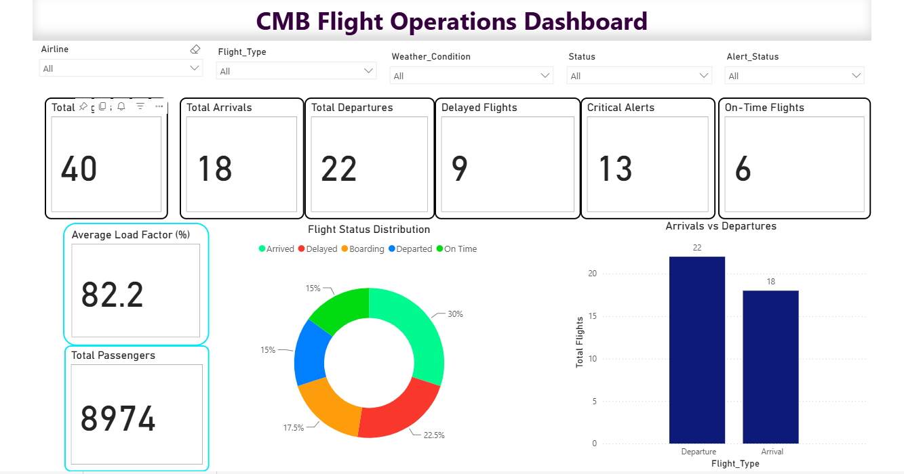
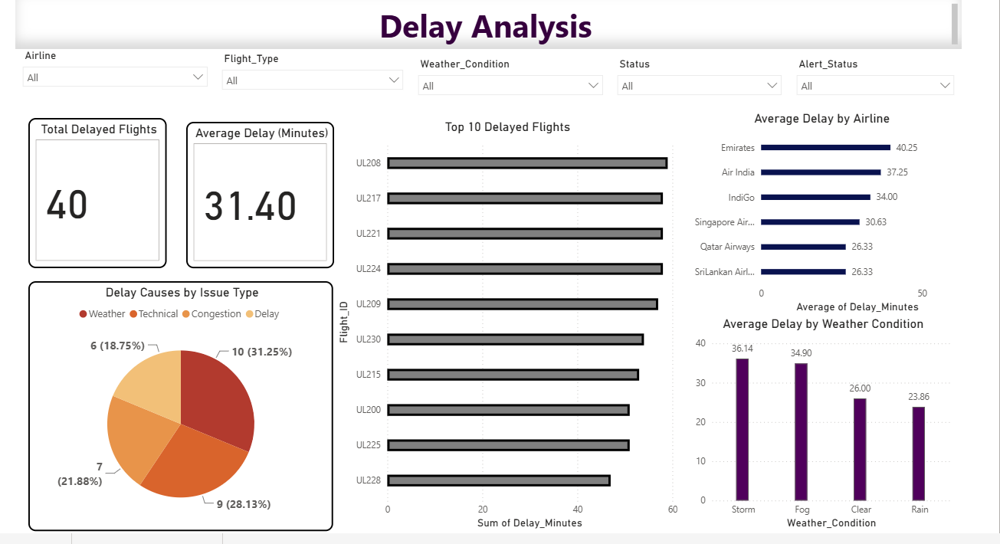
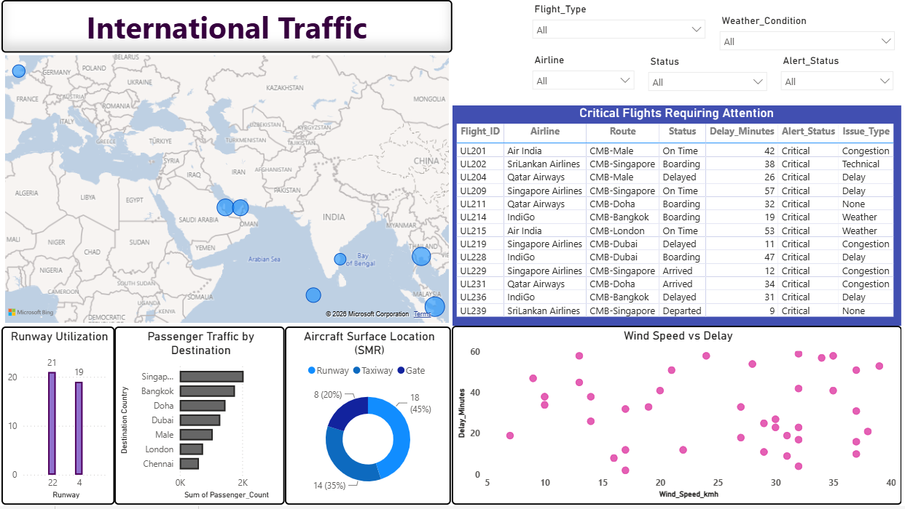
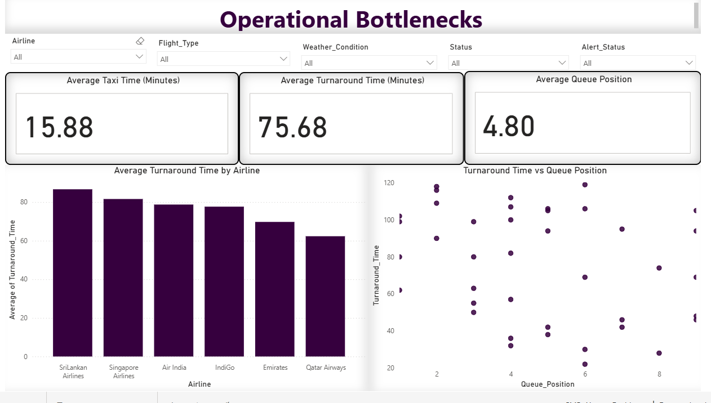

# BI Dashboard for Bandaranaike International Airport (CMB)

## Project Overview

This project presents an interactive Business Intelligence dashboard developed in Microsoft Power BI to analyze flight operations at Bandaranaike International Airport (CMB), Sri Lanka.

The dashboard consolidates flight schedules, delays, weather conditions, international passenger traffic, radar tracking, and ground operations into four interactive report pages. It is designed to help users monitor operational performance, identify potential bottlenecks, and explore flight delay patterns through data visualization.

## Objectives

- Monitor flight arrivals, departures, delays, and critical alerts.
- Analyze delays by airline, weather condition, and reported cause.
- Explore international passenger traffic by destination.
- Examine runway utilization and radar-tracked aircraft locations.
- Identify potential ground-operation bottlenecks using taxi time, turnaround time, and queue position.

## Tools and Technologies

- Microsoft Power BI
- Power Query for data cleaning and transformation
- DAX for measures and calculated columns
- Interactive data visualization and dashboard design

## Dataset

The project uses `BIA_CMB_Dataset.csv`, containing 40 records and 28 fields related to flight schedules, operational delays, weather conditions, radar tracking, and passenger information.

**Note:** The dataset is small, so the findings are exploratory and should not be treated as statistically conclusive or as a representation of actual airport-wide performance.

## Dashboard Pages

### 1. Executive Overview

Displays key flight-operation KPIs, flight status distribution, arrivals, departures, passenger totals, and critical alerts.



### 2. Delay Analysis

Examines average delays, the most delayed flights, airline performance, reported delay causes, and delay patterns across weather conditions.



### 3. International Traffic

Explores destination-level passenger traffic, aircraft surface locations, runway utilization, wind speed versus delay, and critical flights.



### 4. Operational Bottlenecks

Analyzes taxi time, turnaround time, queue position, turnaround performance by airline, and the relationship between turnaround time and queue position.



## Key Findings

- All 40 records showed delays, ranging from 2 to 59 minutes.
- Average recorded delay was 31.4 minutes.
- Weather and technical issues were the leading reported delay causes among records with a recorded issue type.
- Singapore and Bangkok were the highest-volume destinations in the dataset.
- Runway utilization was relatively balanced across the two recorded runways.
- Average turnaround time was 75.7 minutes, highlighting an area for further operational investigation.

These findings are based on a limited dataset and require validation against a larger, multi-day dataset before being used for operational decisions.

## DAX and Data Preparation

The project includes 13 DAX measures for flight monitoring, delay analysis, passenger metrics, and operational performance.

A calculated column, `Destination Country`, extracts destination names from the `Route` field to support country-level traffic analysis.

Power Query was used to correct relevant data types before loading the cleaned data into Power BI.

## Interactive Features

Five slicers are used across the report pages:

- Airline
- Flight Type
- Weather Condition
- Status
- Alert Status

These slicers allow users to explore the report using different operational filters.

## Project Structure

```text
cmb-airport-bi-dashboard/
├── CMB_Airport_Dashboard.pbix
├── BIA_CMB_Dataset.csv
├── README.md
└── screenshots/
    ├── executive-overview.png
    ├── delay-analysis.png
    ├── international-traffic.png
    └── operational-bottlenecks.png
```

The dataset should only be included in the public repository if it is permitted to be shared.

## Limitations

The dataset contains only 40 records. Category-level comparisons and average values are therefore indicative rather than statistically reliable. A larger dataset covering multiple days would be needed to validate the patterns identified.

## Conclusion

This project demonstrates how Power BI, Power Query, and DAX can be combined to create an interactive BI dashboard for flight-operation monitoring, delay analysis, international traffic exploration, and operational bottleneck investigation.